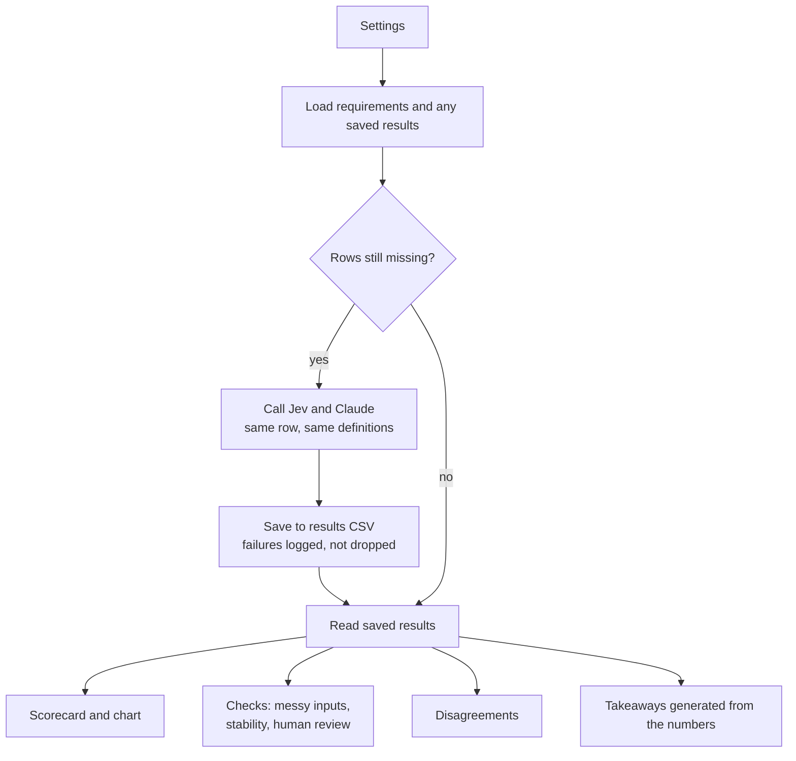

# Jev vs. Claude: Benchmarking AI on software requirement classification

**Why this experiment:** As a Product Manager working on healthcare data quality, I deal with classification and data labeling tasks where decisions need to be made accurately and at scale. I wanted to explore whether a purpose-built decision model like Jev could be a faster, cheaper alternative to a general-purpose LLM for these tasks.

Jev (TypeSafe AI) claims to be up to 193x faster and 444x cheaper than general-purpose LLMs on decision tasks. I tested these claims against Claude using a straightforward classification problem: labeling software requirements as **functional** (what the system does) or **non-functional** (how well it does it).

## Models compared

- **Jev:** Decision model that returns a fixed classification and confidence score, without an explanation.
- **Claude:** General-purpose LLM that returns the same classification with a one-line rationale.

Both received identical definitions and neither was trained on the evaluation data.

## Dataset

Human-labeled software requirements from [`limsc/fr-nfr-classification`](https://huggingface.co/datasets/limsc/fr-nfr-classification) on Hugging Face, plus a small set of messy requirements:

| Set | Size | Source | Purpose |
|---|---|---|---|
| Development | 143 | Hugging Face validation split | Used to refine prompts and select the review threshold |
| Test | 144 | Hugging Face test split | Held out and used only for the final evaluation |
| Messy | 36 | [`data/messy_requirements.csv`](data/messy_requirements.csv) | Multi-sentence requirements with typos, jargon and less structured wording |

The Hugging Face train split (669 rows) is not used, since neither model is trained.

## Evaluation

Accuracy, processing speed, cost at volume, consistency across repeated runs, and automation potential (what can be classified automatically versus routed for human review).

| Check | Question it answers |
|---|---|
| Accuracy, precision, recall | How often does each model match the human label? |
| Speed and cost | Median and slowest-5% response time; estimated cost per month at volume |
| Messy inputs | Does accuracy hold up on realistic, unstructured text? |
| Consistency | Does each model give the same answer when asked 3 times? |
| Human review | If uncertain items go to a person, what share can be automated, and how accurate is it? |
| Disagreements | Where do the models differ, and which one matched the human label? |

## Results

_To be added after the final run._

## How it works



Results are cached in `results/`, so rerunning the notebook only calls the APIs for rows that are missing or failed. All tables and charts are built from the saved results, so they can be regenerated without any API calls.

## Methodology notes

- **Tune on development, score on test.** Prompt wording and the human-review threshold are chosen on the development set only. The test set is run once, after the wording is final.
- **Paired comparison.** Metrics use only requirements that both models answered, so neither gets an easier set.
- **Significance.** An exact McNemar test checks whether the accuracy gap could be chance, given how few requirements the models disagree on.
- **Confidence is not certainty.** Jev's confidence score shows how concentrated its answer is, not a guaranteed probability of being correct. That's why the review threshold is validated on data it wasn't chosen on.
- **Takeaways are computed.** The summary at the end is generated from the results, not written by hand.

## Run it yourself

**1. Install** (Python 3.10 or newer)

```bash
pip install -r requirements.txt
```

**2. Get API keys**
- TypeSafe (Jev): [console.typesafe.ai/keys](https://console.typesafe.ai/keys)
- Anthropic (Claude): [console.anthropic.com](https://console.anthropic.com)

Set them as environment variables (`TYPESAFE_API_KEY`, `ANTHROPIC_API_KEY`), or paste them when the notebook asks. Keys are never printed or saved.

**3. Run in two stages**

Open `jev_vs_claude.ipynb` and:

1. Keep `STAGE = "tune"` to run the development set. Review the mistakes, adjust the definitions if needed, and rerun as often as you like.
2. Set `STAGE = "final"` and `LIMIT = None`, then run once. This runs development, test and messy sets, three times each.

`CLAUDE_MODEL` can be switched between `claude-opus-5-5` and `claude-haiku-5-5`. Each model's results are saved to their own file.

## Repository structure

```
jev-vs-claude/
├── jev_vs_claude.ipynb        # the full experiment
├── data/
│   └── messy_requirements.csv # 36 messy requirements with labels
├── results/                   # saved results and chart (created by the notebook)
├── requirements.txt
└── LICENSE
```

## Not tested here, but needed before real-world use

- **Drift:** writing styles change and providers update their models. Re-label a small random sample regularly.
- **Explainability:** Jev can't say why it chose a label; Claude can. This matters for disputes and audits.
- **Data privacy:** real requirements may be confidential. Check retention, contracts and processing location before using an outside API.
- **Load:** this measured one call at a time. Real traffic brings rate limits and bursts.
- **Cost of a wrong label:** what a mislabel actually breaks sets the accuracy target.

## Limitations

The Hugging Face dataset is undocumented and appears to derive from the public PROMISE benchmark, which both models may have seen during training. The messy set was generated with Claude's assistance, which could bias those results in Claude's favor. Prices used for cost estimates come from third-party reports and should be verified. Findings apply only to these two configurations and this classification task.

## License

Code is released under the MIT License. The Hugging Face dataset is subject to its own terms.
